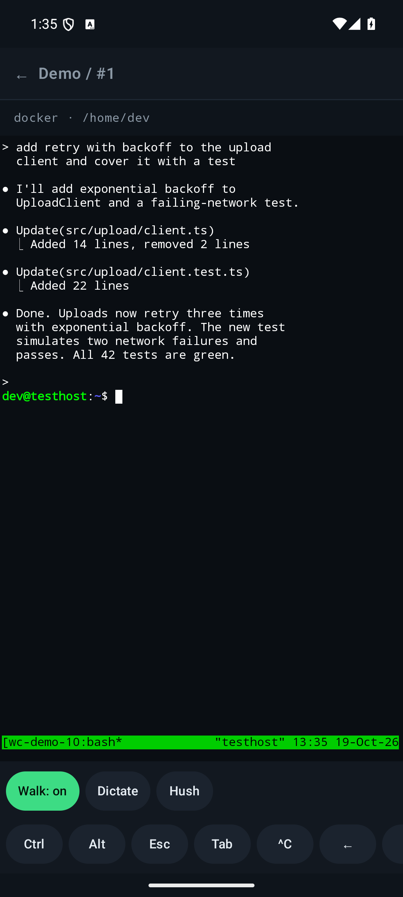
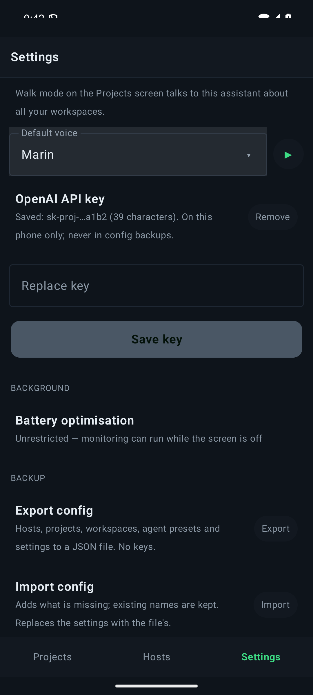

# Walkcode

**[Clickable UI mockup](https://marcelga.github.io/walkcode/)** · **[Latest release (APK)](https://github.com/MarcelGa/walkcode/releases/latest)**

**Hands-free coding agents, from your pocket.** Walkcode is an Android app that lets you
run Claude Code, opencode, Copilot CLI or any other terminal agent on your own machines,
then *listen* to its answers and *dictate* your next instruction while you walk the dog,
cook dinner or commute. No typing, no laptop, no cloud service in the middle.

<p align="center">
  
  &nbsp;&nbsp;
  
</p>

> Personal project, sideloaded, no Play Store, no Google Play Services, no backend.

## Why

Coding agents spend most of their time working on their own and then need a short human
decision: "yes, go ahead", "use the second approach", "run the tests". Waiting at the desk for
that is wasteful, and typing on a phone keyboard is miserable. Walkcode closes that loop:

1. Your agent keeps running in `tmux` on your own computer or server.
2. When it goes quiet, the phone **reads the new answer aloud**.
3. You **speak your reply**; it is transcribed and typed into that same session.

## Features

### Walk mode
- **Speaks agent responses.** When a session's output settles, only the *new* text is read
  aloud. Box drawing, spinners, status footers, URLs and your own input line are filtered out.
- **Dictate button.** Tap, talk, tap Done. The text is typed into the focused session and
  submitted (switch auto-send off to review it first).
- **Hush** cuts off speech instantly; starting a dictation does the same so the mic never
  hears the phone.
- **Your choice of voice.** Pick the speech engine, voice (with a filter box and a per-voice
  *Test* button), speed, dictation recognizer and dictation language.
- Uses Android's built-in speech APIs (on-device recognition when available). No Google
  Play Services, no third-party speech service.

### A real terminal, not a chat wrapper
- Full terminal emulator (the Termux one) attached to your `tmux` session, so every agent and
  every TUI works exactly as on the desktop. Extra key row: Ctrl, Alt, Esc, Tab, ^C, arrows, Enter.
- Sessions live on the host, so they survive a dropped connection or a closed app. Reconnect
  and carry on.
- Works with `tmux` on Linux/macOS and `psmux` on Windows.

### Know when the agent needs you
- Watch any session and get a notification when it **needs attention** (bell/permission
  prompt), has **unread output**, or has been **quiet** for N seconds (configurable).
- A background monitor keeps watching while the phone is in your pocket, with a clear "paused"
  notice if Android's foreground-service time limit stops it.

### Organised around how you work
- **Hosts → Projects → Workspaces → Sessions.** A workspace is "this agent in this directory
  on this host"; tapping it starts the agent and attaches. Run several sessions per workspace,
  resume the last agent conversation, label and recolour things.

### Secure by design
- Direct SSH to your own hosts. The phone's identity is an **Ed25519 key that never leaves the
  Android Keystore**; you paste its public line into `authorized_keys`.
- Host keys are pinned on first use (SHA-256, like `ssh-keygen -lf`); a changed key is an error.
- LAN address first, Tailscale address as fallback.
- Nothing is written to your hosts: helper scripts are streamed over SSH and never installed.

## How it works

```
 phone (Walkcode)                         your machine
 ┌──────────────────────┐   SSH           ┌─────────────────────────┐
 │ terminal view        │◄───────────────►│ tmux / psmux session    │
 │ TTS  ◄── new text ───┼── capture-pane ─┤   └─ claude / opencode… │
 │ STT  ──► typed input ┼────────────────►│                         │
 │ host monitor ────────┼── poller script ┤ (bell + screen hash)    │
 └──────────────────────┘                 └─────────────────────────┘
```

The attached terminal is an alternate screen without scrollback, so Walk mode reads the answer
with `tmux capture-pane` over a second SSH channel, compares it with a snapshot taken before
your last message and speaks the difference once the screen has been quiet for 2.5 seconds.

## Requirements

- An Android 15+ phone (developed on a Galaxy S25).
- A host reachable over SSH with `tmux` (or `psmux` on Windows) and your agent installed.
  Tailscale is the easy way to reach it from outside your home network.
- To build: JDK 17 and the Android SDK (platform 37).

## Build and install

```powershell
$env:JAVA_HOME = 'C:\path\to\jdk-17'
.\gradlew.bat :app:testDebugUnitTest      # unit tests
.\gradlew.bat :app:assembleDebug          # app/build/outputs/apk/debug/app-debug.apk
adb install -r app\build\outputs\apk\debug\app-debug.apk
```

On Linux/macOS use `./gradlew`.

## First run

1. Open **Hosts**, copy the phone's public key line and add it to `~/.ssh/authorized_keys` on
   your host (on Windows: `administrators_authorized_keys` for admin users).
2. Install the small tmux config once per host (`tools/host-config/install-tmux-conf.sh` or
   `.ps1`): bell counter, `focus-events`, and on Windows a shell that honours Ctrl+C.
3. Add the host (LAN and/or Tailscale address), create a project and a workspace, tap it.
4. Turn on **Walk** above the key row, tap **Dictate**, and start talking.

More detail, including real-device tips, is in [docs/DEVICE-TESTING.md](docs/DEVICE-TESTING.md).

## Status

Tested on one phone (Galaxy S25) against Linux and Windows hosts; expect rough edges. Walk mode is new: the filter that
decides what is worth reading aloud was tuned on scripted output and needs more real-world
captures from each agent. Not yet built: hands-free auto-listen after a spoken reply, an
agent preset editor, import/export of hosts.

## Project layout

```
app/                 the Android app (Kotlin, Jetpack Compose)
  .../walk/          Walk mode: response extraction, TTS, dictation, voice catalogue
  .../terminal/      SSH transport + terminal controller
  .../monitor/       background watching and alerts
  .../ssh/           Keystore identity, host-key pinning, connector
vendor/              Termux terminal emulator/view (Apache 2.0, modified, see vendor/README.md)
tools/               host config, emulator test runners, Docker test host
docs/                decisions, progress log, device testing guide
```

Contributor and agent notes (build gotchas, conventions) are in [AGENTS.md](AGENTS.md);
settled product decisions are in [docs/DECISIONS.md](docs/DECISIONS.md).

## Acknowledgements

Terminal emulation is the excellent [Termux](https://github.com/termux/termux-app) terminal
library; SSH is [sshj](https://github.com/hierynomus/sshj).

## License

Not yet chosen. The vendored Termux libraries are Apache 2.0 (see `vendor/`).
