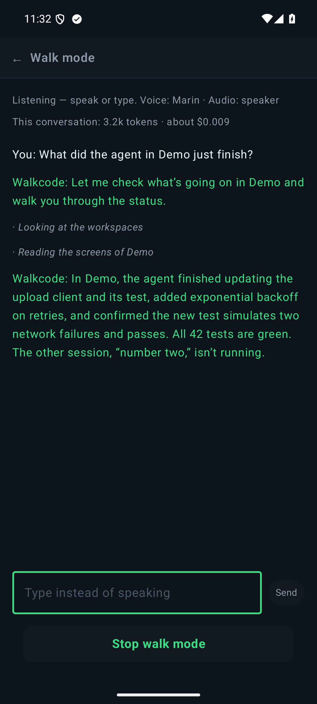
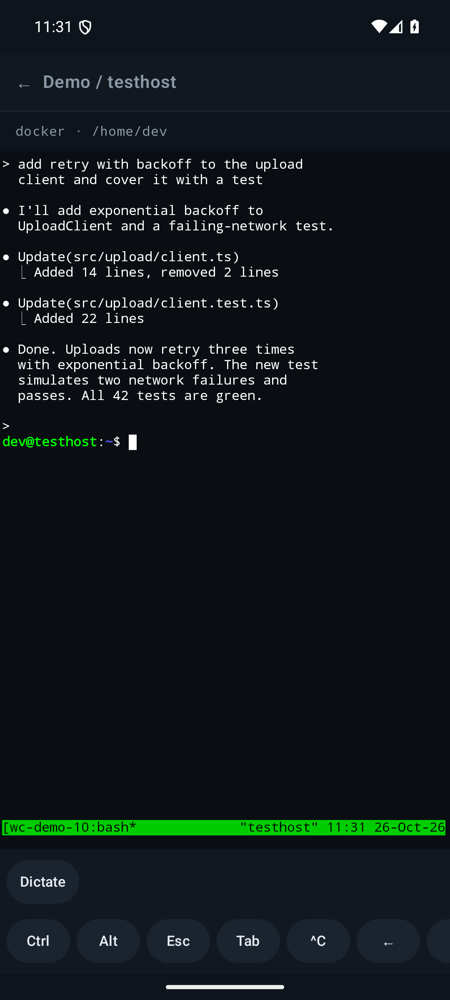

# Walkcode

**[Clickable UI mockup](https://marcelga.github.io/walkcode/)** · **[Latest release (APK)](https://github.com/MarcelGa/walkcode/releases/latest)**

**Hands-free coding agents, from your pocket.** Walkcode is an Android app that lets you
run Claude Code, opencode, Copilot CLI or any other terminal agent on your own machines,
then *talk* to them while you walk the dog, cook dinner or commute: ask what they are doing,
hear who is waiting for you, and answer by voice. No laptop, no server of your own in the middle.

<p align="center">
  
  &nbsp;
  
  &nbsp;
  
</p>

> Personal project, sideloaded, no Play Store, no Google Play Services, no backend. Walk mode's
> voice assistant uses the OpenAI Realtime API with your own key (see below).

## Why

Coding agents spend most of their time working on their own and then need a short human
decision: "yes, go ahead", "use the second approach", "run the tests". Waiting at the desk for
that is wasteful, and typing on a phone keyboard is miserable. Walkcode closes that loop:

1. Your agents keep running in `tmux` on your own computer or server.
2. With **walk mode** on, you ask the phone *"what's going on?"*; a voice assistant reads every
   session's screen and tells you what finished and which agent is waiting for an answer.
3. You **say your answer**; the assistant reads it back and, after your yes, types it into that session.

## Features

### Walk mode: a voice assistant for all your workspaces
- **One switch on the Projects screen.** The assistant then listens for as long as you like,
  also with the phone locked (a notification with Stop shows while it runs).
- **It looks before it talks.** It lists your workspaces and sessions, reads the last lines of
  their screens over SSH and summarises: what the agent did, what failed, what it asks you.
  The conversation screen shows each thing it looked at.
- **Nothing is typed without your yes.** To answer an agent it prepares the exact text, reads it
  back, and sends only that text after you confirm.
- **Talk or type.** Speech in and out (interrupt it any time), or type when it is loud.
  Pick one of OpenAI's preset voices in Settings, with a play button to compare them.
- **See what it costs.** Pick the Realtime model (the mini one is about a third of the price) and
  watch the spend: the walk screen shows this conversation's tokens and estimated dollars, and
  Settings shows today, this month and all time, from the usage OpenAI reports after each reply.
  Background noise is filtered, so wind and traffic do not start paid replies.
- **Privacy:** walk mode sends your speech and the screen text it reads to OpenAI, with your own
  API key (stored only on the phone, never in config backups). Everything else stays between
  the phone and your hosts.

### Dictate into a session
- In the terminal, tap **Dictate**, talk, tap Done. The text is typed into the session and
  submitted (switch auto-send off to review it first). Uses Android's own recognizer
  (on-device when available), no Google Play Services.

### A real terminal, not a chat wrapper
- Full terminal emulator (the Termux one) attached to your `tmux` session, so every agent and
  every TUI works exactly as on the desktop. Extra key row: Ctrl, Alt, Esc, Tab, ^C, arrows, Enter.
- Sessions live on the host, so they survive a dropped connection or a closed app. Reconnect
  and carry on.
- Works with `tmux` on Linux/macOS and `psmux` on Windows.

### Know when the agent needs you
- Watch any session and get a notification when it **needs attention** (bell/permission
  prompt), has **unread output**, or has been **quiet** for N seconds (configurable).
- A background monitor keeps watching while the phone is in your pocket, with a clear "paused"
  notice if Android's foreground-service time limit stops it.

### Organised around how you work
- **Hosts → Projects → Workspaces → Sessions.** A workspace is "this agent in this directory
  on this host"; tapping it starts the agent and attaches. Run several sessions per workspace,
  resume the last agent conversation, label and recolour things.

### Secure by design
- Direct SSH to your own hosts. The phone's identity is an **Ed25519 key that never leaves the
  Android Keystore**; you paste its public line into `authorized_keys`.
- Host keys are pinned on first use (SHA-256, like `ssh-keygen -lf`); a changed key is an error.
- LAN address first, Tailscale address as fallback.
- Nothing is written to your hosts: helper scripts are streamed over SSH and never installed.

## How it works

```
 OpenAI Realtime API          phone (Walkcode)                     your machines
 ┌─────────────────┐  voice  ┌──────────────────────┐   SSH        ┌─────────────────────────┐
 │ speech in/out   │◄───────►│ walk mode assistant ─┼─ capture-pane│ tmux / psmux sessions   │
 │ function calls ─┼────────►│   (list, read, send) ┼─ send-keys ─►│   └─ claude / opencode… │
 └─────────────────┘         │ terminal view        │◄────────────►│                         │
                             │ dictation (on-device)┼─ typed input►│                         │
                             │ host monitor ────────┼─ poller ─────┤ (bell + screen hash)    │
                             └──────────────────────┘              └─────────────────────────┘
```

Walk mode streams your voice to the Realtime API over a WebSocket from the phone itself; there is
no Walkcode server. When the model needs to know something it calls one of the app's functions:
the phone then reads the sessions' screens with `tmux capture-pane` over SSH (or, after your yes,
types into one with `send-keys`) and hands the text back, and the model answers out loud.

## Requirements

- An Android 15+ phone (developed on a Galaxy S25).
- A host reachable over SSH with `tmux` (or `psmux` on Windows) and your agent installed.
  Tailscale is the easy way to reach it from outside your home network.
- To build: JDK 17 and the Android SDK (platform 37).

## Build and install

```powershell
$env:JAVA_HOME = 'C:\path\to\jdk-17'
.\gradlew.bat :app:testDebugUnitTest      # unit tests
.\gradlew.bat :app:assembleDebug          # app/build/outputs/apk/debug/app-debug.apk
adb install -r app\build\outputs\apk\debug\app-debug.apk
```

On Linux/macOS use `./gradlew`.

## First run

1. Open **Hosts**, copy the phone's public key line and add it to `~/.ssh/authorized_keys` on
   your host (on Windows: `administrators_authorized_keys` for admin users).
2. Install the small tmux config once per host (`tools/host-config/install-tmux-conf.sh` or
   `.ps1`): bell counter, `focus-events`, and on Windows a shell that honours Ctrl+C.
3. Add the host (LAN and/or Tailscale address), create a project and a workspace, tap it.
4. For walk mode, paste an OpenAI API key in **Settings → Dictation and walk mode** (the account
   needs API credit), then tap **Walk: off** on the Projects screen and ask what is going on.

More detail, including real-device tips, is in [docs/DEVICE-TESTING.md](docs/DEVICE-TESTING.md).

## Status

Tested on one phone (Galaxy S25) against Linux and Windows hosts; expect rough edges. Walk mode is
new: it works on the phone (also locked), but its summaries of real agent screens need more
real-world use. Planned: a voice and persona per workspace.

## Project layout

```
app/                 the Android app (Kotlin, Jetpack Compose)
  .../assistant/     walk mode: the app-wide assistant, its workspace functions, the mic service
  .../voice/         OpenAI Realtime protocol, WebSocket client, audio in/out, key handling
  .../walk/          dictation, screen-text cleaning, recognizer catalogue
  .../terminal/      SSH transport + terminal controller
  .../monitor/       background watching and alerts
  .../ssh/           Keystore identity, host-key pinning, connector
vendor/              Termux terminal emulator/view (Apache 2.0, modified, see vendor/README.md)
tools/               host config, emulator test runners, Docker test host
docs/                decisions, progress log, device testing guide
```

Contributor and agent notes (build gotchas, conventions) are in [AGENTS.md](AGENTS.md);
settled product decisions are in [docs/DECISIONS.md](docs/DECISIONS.md).

## Acknowledgements

Terminal emulation is the excellent [Termux](https://github.com/termux/termux-app) terminal
library; SSH is [sshj](https://github.com/hierynomus/sshj).

## License

Not yet chosen. The vendored Termux libraries are Apache 2.0 (see `vendor/`).
